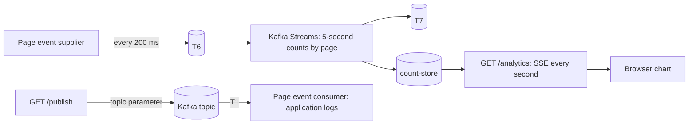
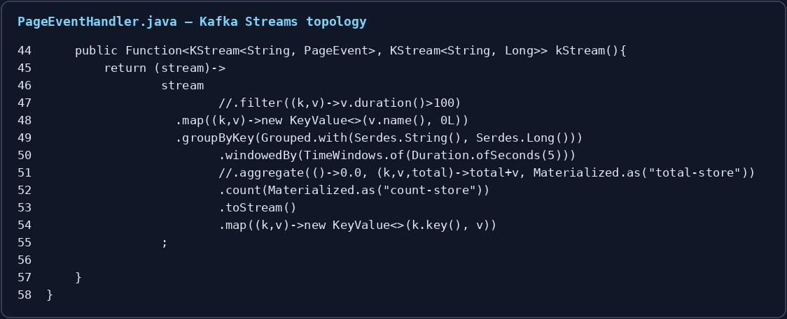
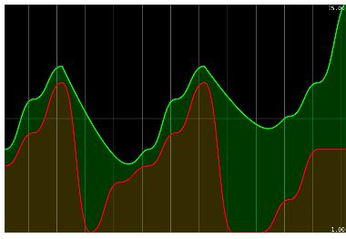
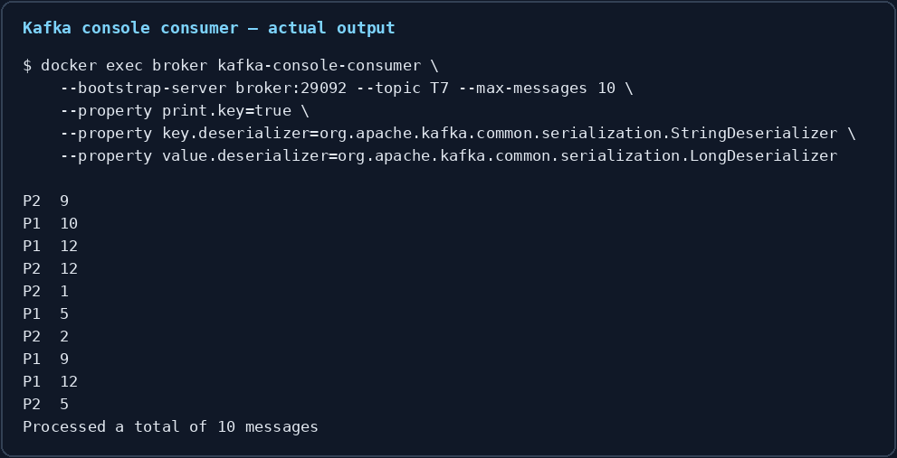

# Event-driven analytics with Kafka and Spring Cloud Stream

A learning project that generates page visits, processes them with Kafka Streams, and displays live counts in a browser. It demonstrates a Spring Cloud Stream consumer and supplier, an HTTP publisher, windowed aggregation, interactive state-store queries, and Server-Sent Events (SSE).

## How it works



A `PageEvent` contains a page name, user, date, and duration. The supplier randomly generates `P1` or `P2` and `U1` or `U2`, then sends events to `T6`. The stream groups events by page name and counts them in five-second windows. It writes count updates to `T7` and materializes them in `count-store`. The `/analytics` endpoint queries recent windows and sends maps of counts to the page using SSE. The chart shows **P1 in green** and **P2 in red**. Window counts restart as new windows begin; they are not cumulative totals.

The separate consumer listens on `T1` and prints received `PageEvent` objects. `/publish` sends an event to a topic selected by the request; publish to `T1` to see the consumer in action. Publish to `T6` to feed the analytics stream.

### Stream processing code

The following image is a rendering of the actual source in [`PageEventHandler.java`](src/main/java/net/youssfi/springkafka/hanndlers/PageEventHandler.java):



## Requirements

- Java 21 (the version specified in `pom.xml`) and the included Maven wrapper, or Maven.
- Docker and Docker Compose for Kafka and ZooKeeper.
- A browser with network access to the Smoothie Charts CDN used by the page.
- Ports `9092` and `8080` available on the host.

## Start the project

From the project directory, start ZooKeeper and the Kafka broker:

```bash
docker compose up -d
docker compose ps
```

The Compose file exposes Kafka on `localhost:9092`. Containers on the Compose network use `broker:29092` as the internal Kafka address. Wait for Kafka to finish starting, then run the application in another terminal:

```bash
./mvnw spring-boot:run
```

On Windows use `mvnw.cmd spring-boot:run`. Open [http://localhost:8080/](http://localhost:8080/) and allow a few seconds for the stream and state store to initialize. The supplier starts producing events automatically.

### Live graph

This screenshot was captured from the running application. The curves update as the counts change:



## Try the endpoints

Publish an event to `T1`; inspect the application logs for the consumer output:

```bash
curl "http://localhost:8080/publish?name=P1&topic=T1"
```

Watch the data used by the graph (stop with `Ctrl+C`):

```bash
curl -N http://localhost:8080/analytics
```

The SSE messages have a form such as `data:{"P1":12,"P2":9}`. Counts change continuously. Immediately after startup, the store may not yet be queryable; retry once Kafka Streams has initialized.

## Kafka console commands

[`commands.txt`](commands.txt) contains the original Windows and Docker examples. The examples below use the topic names configured in `application.properties` and the internal listener, `broker:29092`. Commands that follow events keep running until `Ctrl+C`.

List topics:

```bash
docker exec broker kafka-topics --bootstrap-server broker:29092 --list
```

Read generated events from `T6`:

```bash
docker exec -it broker kafka-console-consumer \
  --bootstrap-server broker:29092 --topic T6
```

Read the aggregated page counts from `T7` as string keys and long values:

```bash
docker exec -it broker kafka-console-consumer \
  --bootstrap-server broker:29092 --topic T7 \
  --property print.key=true \
  --property key.deserializer=org.apache.kafka.common.serialization.StringDeserializer \
  --property value.deserializer=org.apache.kafka.common.serialization.LongDeserializer
```

A real execution of that consumer, limited to ten messages with `--max-messages 10`, produced the following output. The image renders the captured terminal text:



To experiment with the independent `R2` topic from `commands.txt`, start a consumer and producer in separate terminals, then type messages into the producer:

```bash
# Terminal 1
docker exec -it broker kafka-console-consumer \
  --bootstrap-server broker:29092 --topic R2

# Terminal 2
docker exec -it broker kafka-console-producer \
  --bootstrap-server broker:29092 --topic R2
```

`R2`, `R4`, and `R66` in the original command notes are examples, not the configured analytics input and output topics. The `.bat` commands in that file are an alternative for a local Windows Kafka installation; start ZooKeeper and Kafka there before running its producer or consumer.

## Configuration and project files

- [`application.properties`](src/main/resources/application.properties): function definitions, topics, polling and stream commit interval.
- [`PageEvent.java`](src/main/java/net/youssfi/springkafka/events/PageEvent.java): event record.
- [`PageEventHandler.java`](src/main/java/net/youssfi/springkafka/hanndlers/PageEventHandler.java): consumer, supplier and stream topology.
- [`PageEventController.java`](src/main/java/net/youssfi/springkafka/controllers/PageEventController.java): HTTP publisher and SSE analytics endpoint.
- [`index.html`](src/main/resources/static/index.html): Smoothie Charts client.
- [`compose.yml`](compose.yml): single-broker Kafka and ZooKeeper setup for local learning.

## Tests and shutdown

```bash
./mvnw test
docker compose down
```

Stop the Spring application with `Ctrl+C` first. The context test starts the stream components and expects Kafka to be available; avoid running another instance with the same local Kafka Streams state directory at the same time. This Compose setup is intended for local development, not production.
